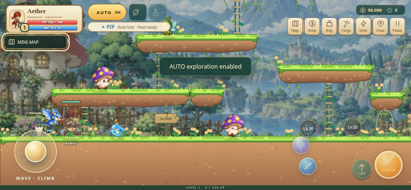

# AetherStory M: Chronicles of Aetheria

An original mobile-first Canvas action RPG built from the supplied platform/rope combat prototypes. Explore illustrated fantasy hunting grounds, fight manually or with AUTO, change class, collect equipment and save progress on your device. No backend, database or account is needed.



## Run locally

Use Node.js 22.12+ (development environment: Node 24).

```sh
npm ci
npm run dev
```

Open the URL Vite prints. To test on a phone on the same network, open the development machine's LAN IP with port 5173. Ordinary HTTP LAN access supports gameplay; offline installation requires HTTPS or localhost.

```sh
npm test
npm run build
npm run preview
```

The production build is the `dist/` directory. Deploy its contents to an HTTPS static host. Relative asset paths support subdirectory hosting. Do not open `index.html` using a `file://` URL.

### GitHub Pages

Production is published only by [.github/workflows/pages.yml](.github/workflows/pages.yml) after a **push to main** passes unit tests, the production build and browser tests. Pull requests validate through CI and never deploy. Do not push production files to a publishing branch.

Repository setup: **Settings → Pages → Source → GitHub Actions**. If the repository is still configured to deploy from its old branch, the owner must select GitHub Actions before the new main workflow can deploy. GitHub currently reports the old publishing-branch source and an environment policy restricted to that branch. The integration cannot change these admin settings (HTTP 403). Also set **Settings → Environments → github-pages → Deployment branches and tags** to allow only **main**, removing the old branch rule. No deployment is attempted by this PR. The workflow uploads `dist/` and uses the `github-pages` environment. Its trigger and deployment guards both require `main`.

For a portable **single HTML file**, run `npm run build:html`. This produces `artifacts/AetherStory.html` with the JavaScript, styles, icons and original Canvas art embedded. It needs no asset folder or network connection. Open the downloaded HTML in a browser that permits local HTML scripts; phone file previewers may display a preview without running the game. This export does not register a service worker; saves remain browser-dependent. A ready-made copy is included as `AetherStory.html` in the repository.

## Play

Move with **A/D** or **←/→**. Climb ropes/ladders with **W/S** or **↑/↓**. Press **Space** to jump; **Down + Space** drops through a floating platform. Press **J** to attack or hold the attack button. Skills use **Z/K**, **X**, **C**, **V** (ultimate). **F** activates your class buff from Lv.3; the HUD shows remaining duration and cooldown. **E** interacts with Elder Rowan or nearby portals and collects nearby loot. On mobile, drag the analog joystick to move or climb and use the other hand for jump, attacks and skills. The stick supports slower walking, diagonal climbing input, pointer cancellation and independent fingers.

**T/B** toggles AUTO within your selected hunting area. Unlocking a harder area does not automatically send you there. Use the world map or a portal when prepared. Manual movement immediately takes priority. **Q** opens the quest journal, **I** opens inventory, **P** character, **M** world map, **G** forge, **U** skills, **O** settings and **Escape** pause/close. **Enter** begins the adventure.

**The lantern trail** adds seventeen original quests across four chapters. Tap a nearby guide or press **E / Collect** to talk, accept a mission, and return for rewards. Choose **Follow quest** to opt into AUTO-quest: it travels through unlocked portals, hunts the right creatures, gathers quest drops with Pip, climbs to beacons and returns to the giver. Level requirements still apply. Manual movement takes priority; death, an impossible route and an active guardian objective stop quest automation. The final fight requires manual dodging. Quest progress saves locally, but AUTO-quest never resumes automatically after reload. Ordinary AUTO still hunts your selected area.

**Rowan’s daily board** offers three shared bounties per local calendar day, accessible at any area’s guide. Hunts in all areas count, including story hunts. Accept and claim near a guide; the 25/50/100-kill goals award gold, cores, tonics and 2%/3%/5% of the current next-level XP requirement. The board resets at local midnight, and saved claims cannot be paid twice after reload. AUTO-quest reserves a short bounty for each longer story level gate; you can accept early from any guide.

**Character growth:** The character sheet shows combat power, STR / DEX / INT / LUK, critical chance/damage, gear contributions and current attack/defense. Each level increases attack by 4, defense by 2, HP by 28 and MP by 7, with a visible gain summary. Class buffs last 12 seconds with a 45-second cooldown; AUTO uses them during combat. Ultimate arts unlock at Lv.25, deal 1,000% total attack damage and have original animations for each class.

**Equipment rarity:** Normal / Rare / Epic / Unique / Mythic gear has distinct colors and real stat differences. Ordinary monsters can drop up to Epic (Unique in higher areas); bosses guarantee Epic or better with a chance of Mythic. The Bag has category filters, rarity sorting, upgrade indicators and a six-slot worn-gear overview.

**Bag tools:** Equip Best uses the same starred main-stat comparison as AUTO and keeps swapped gear. Dismantle Low Gear previews Normal/Rare spares, with an optional Epic checkbox, and confirms the exact gold/core payout. Equipped, starred, locked and non-gear items are protected. Padlocks survive reload; locked gear cannot be salvaged individually. Cancel leaves equipment and rewards unchanged.

**AUTO preparation:** AUTO and AUTO-quest equip strictly better gear from the bag, keeping displaced pieces. AUTO-quest stays in the current area if attack/defense do not meet the next area’s preparation thresholds; the tracker points to Bag / Forge / Shop. Low-health AUTO stops attacking and retreats to recover while healing is unavailable. Manual travel and equipment choices remain available.

**Pip, your dragon companion**, automatically flies to gold, equipment and active quest items within 360 world units in both manual and AUTO play. When your HP falls below 70%, Pip restores 11% of your maximum HP, with a 35-second cooldown and no potion cost. Your HUD shows HP, pet activity and healing readiness; the companion cannot revive a defeated hero.

The four classes are Vanguard, Arcanist, Nightblade and Ranger. First and second skills are available immediately; advanced skills unlock at levels 10 and 25. Hunt monsters for XP, collect gold and equipment, equip six gear slots, spend skill points and enhance equipment in the timing-based forge. Defeated monsters respawn; a fallen hero returns safely after a short delay. Later hunting grounds unlock at levels 10, 16 and 20.

Visit **Shop** for 90-gold tonics (45% HP, 10-second cooldown), vitality training (+25 max HP/rank), and weapon mastery (+4 attack/rank). Training costs 250 × (next rank)²; each path has ten ranks. Forge costs rise exponentially with stars, and failed attempts still cost gold and cores. Armor reduces incoming damage but cannot make the hero immune.

Fresh-account AUTO reaches level 10 in about 27 minutes; the measured AUTO-quest route takes about 27 minutes. A reproducible policy that equips loot, salvages spare gear, buys training/tonics and forges gear reaches level 25 in about 3 hours 44 minutes. The boss uses a 150,000 HP fight with **SHOCKWAVE · JUMP** and **METEOR · MOVE** warnings; AUTO is not a substitute for dodging. See the measured scenarios and gear assumptions in [QA](docs/QA.md). Existing saves retain their level; new fields default safely and area access follows the new level gates.

## Save and install

Progress saves locally every five seconds, on equipment/settings changes and when the page is hidden. Equipment, inventory, gold, XP, class, skill levels, Starlight enhancements, area unlocks and settings persist. Version 4 saves migrate earlier modular saves and the supplied version 3 format without removing the original save. Saves belong to this browser and origin. Clearing site data removes them; private browsing can restrict or erase storage. Storage failure does not prevent playing the current session. AUTO expeditions can earn estimated rewards while away: only when AUTO was enabled at departure, never in the boss area, and capped at eight hours. The return summary grants each absence once.

To install, first load the **production HTTPS build** online and let its service worker finish caching. Android Chrome: browser menu → **Install app** or **Add to Home screen**. iPhone Safari: **Share → Add to Home Screen**. Open the installed app once online, then test it in airplane mode. The game code, original artwork, icons and UI are local assets; no CDN or web fonts are required. Installing is browser-dependent and is not necessary to play.

## Automated browser checks

After building:

```sh
npx playwright install chromium
npm run test:e2e
```

CI uses the Ubuntu runner’s preinstalled Chrome to avoid a lengthy dependency download. The test runner starts a production preview on port 4173. It uses `/usr/bin/chromium` if available, otherwise Playwright's installed Chromium. To select a browser binary, set `PLAYWRIGHT_CHROMIUM_EXECUTABLE_PATH`.

Behavior tests cover physics, combat, deaths/respawn, navigation, local saves, touch input and the fixed simulation clock. Browser tests exercise real controls, AUTO, panels, reload persistence, common mobile/desktop viewports and a fully offline production reload. See [QA record](docs/QA.md) for commands, actual results and device-testing limits.

Run `npm run balance` to reproduce the complete balance report (including a four-hour progression policy and boss scenarios); unit tests include a one-hour AUTO regression. The simulation runs real `updateGame` fixed steps without time or stat multipliers.

## Project structure

- `src/game/`: deterministic world, physics, combat, navigation and RPG rules.
- `src/renderer.js`: original Canvas illustrations, animation, camera and effects.
- `src/input.js`, `src/ui.js`, `src/style.css`: multitouch/keyboard input and responsive interface.
- `src/main.js`, `src/loop.js`, `src/audio.js`: lifecycle, fixed-step integration and original synthesized audio.
- `src/save.js`: validated versioned local progress and explicit migrations.
- `src/offline.js`: departure tracking and bounded, once-only AUTO expedition rewards.
- `scripts/build-sw.js`: content-versioned production precache generated from the actual build.

The browser exposes read-only diagnostics through `window.aetherStory.getSnapshot()` and `window.aetherStory.getDiagnostics()` for bug reports. No debug mutation or backend is required.

The illustrated mushroom valley and four-class/creature animation atlases are original AI-generated artwork created for this project and bundled locally as WebP assets. Terrain and effects use local Canvas artwork; sound is synthesized locally. Commercial-game location/boss names and remote libraries from the larger reference snippet are replaced. The larger supplied snippet ended during its combat implementation; this repository contains a new modular implementation rather than claiming to repair code that was not supplied.
